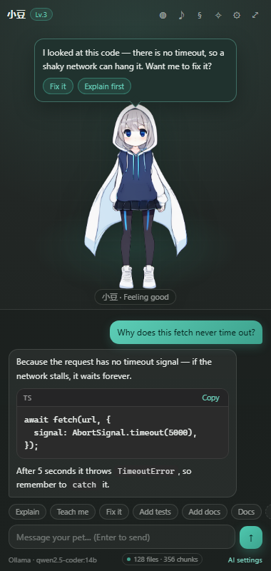
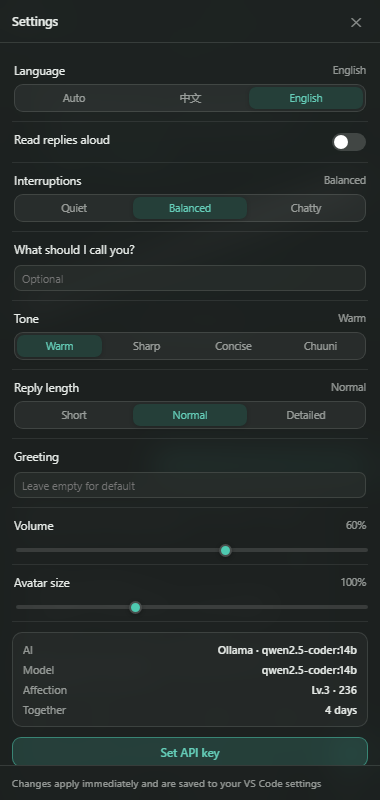

# AI DeskPet

> An AI coding buddy that lives in VS Code: it chats, reads your code, helps you finish the bug, and can wear your own Live2D, 3D, or image avatar.

English | [简体中文](README.md)

- **Two homes**: a permanent sidebar, or a full editor tab.
- **Inline chat**: `Ctrl+Alt+K` asks beside the code; answers are anchored as comment threads with apply / diff links.
- **CodeLens**: Explain / Refactor above every function — no selection, no panel switching.
- **Real code help**: explain a selection, diagnose and fix, refactor, generate tests, write commit messages.
- **Expressive**: happy when a save succeeds, alert on errors, reminds you to take a break.
- **Any avatar**: Live2D (Cubism 4), VRM / GLB, image / GIF — import and go.
- **Any sound**: bind your own clips per scene, or use the built-in synth; optional system TTS.
- **Three AI backends**: local Ollama (default), any OpenAI-compatible endpoint, or the VS Code Language Model API.
- **Fully themeable**: presets, custom accent, background / motion / density, quick actions, custom CSS.
- **Bilingual UI**: follows the VS Code display language; `deskpet.ui.language` can force Chinese or English.

> Requires **VS Code 1.93+** (terminal failure capture uses Shell Integration; other features work on older versions but the extension asks for 1.93).


> Screenshots come from the development preview (`dev/preview.html`).



---

## Features

| Capability | What it does |
| --- | --- |
| DeskPet panel | Sidebar and editor tab share the same conversation and state |
| Streaming chat | Renders while generating, can be stopped; history is stored locally |
| Code explanation | Select code → right-click “Explain selection”, or `Ctrl+Alt+E` |
| Project context | Indexes the repo and attaches related modules, definitions, and conventions |
| Teacher mode | Line-by-line / logic / design depth, grounded in `L12` line numbers |
| Quiet interruptions | Quiet / balanced / chatty; silent while typing; unread badge instead of popups |
| Transparent decisions | Fix/refactor cards show problem, cause, plan, impact before you apply |
| Debug & fix | Live diagnostics, terminal failure capture, stack parsing, patch + auto diff |
| Post-edit verification | Re-checks the current file and up to 4 dependents; one-click undo |
| Test generation | Detects the framework, lists branches first, then writes the test |
| Docs sync | Generates JSDoc / Go doc / docstrings and detects signature drift on save |
| Personalization | Themes, accent, background / motion / density, quick actions, custom CSS, persona |
| Git commit messages | Reads `git diff` and follows Conventional Commits |
| Docs lookup | Fetches doc URLs directly; optional Tavily / Serper search with citations |
| Affection | Clicks, chats, and saves raise affection; level-ups have their own lines |
| Privacy | No telemetry; chat only goes to your configured AI endpoint |

---

## Quick start

### Run from source

```bash
git clone https://github.com/<your-name>/ai-deskpet.git
cd ai-deskpet
npm install
npm run compile
```

Open the folder in VS Code, press **F5** to start the Extension Host, then click the **AI DeskPet** icon in the activity bar.

### Install a packaged vsix

```bash
npm run package
code --install-extension ai-deskpet-0.1.0.vsix
```

### Default AI: local Ollama

```bash
ollama serve
ollama pull qwen2.5-coder:14b
```

The extension already points at `http://127.0.0.1:11434/v1` + `qwen2.5-coder:14b`. To switch models:

```jsonc
{
  "deskpet.ai.provider": "ollama",
  "deskpet.ai.baseUrl": "http://127.0.0.1:11434/v1",
  "deskpet.ai.model": "qwen3-coder:30b"
}
```

> The first local load can take tens of seconds; if VRAM is short, Ollama spills to RAM and slows down.

### Any OpenAI-compatible endpoint

1. Run **AI DeskPet: Set the AI service API key** (`Ctrl+Shift+P` → `deskpet.setApiKey`).
2. Paste the key — it is stored in VS Code SecretStorage, not in `settings.json`.
3. Update the settings:

```jsonc
{
  "deskpet.ai.provider": "openai",
  "deskpet.ai.baseUrl": "https://api.deepseek.com/v1",
  "deskpet.ai.model": "deepseek-chat"
}
```

DeepSeek, Qwen, Kimi, vLLM, LM Studio — anything with an OpenAI-compatible `/chat/completions` works.

### VS Code Language Model API (Copilot)

```jsonc
{ "deskpet.ai.provider": "vscode-lm" }
```

Requires GitHub Copilot to be installed and signed in.

---

## Language

The panel follows the VS Code display language by default. To force a language:

| Setting | Values | Meaning |
| --- | --- | --- |
| `deskpet.ui.language` | `auto` (default) / `zh` / `en` | Panel language and the language the AI answers in |

- The command palette, settings, panel copy, modal dialogs, quick picks, status-bar messages, and inline comment threads are localized (English / Simplified Chinese).
- With `en`, the system prompt switches to English so answers are written in English.
- Switch languages in the panel: **⚙ Settings → Language → Auto / 中文 / English**, or with the `deskpet.ui.language` setting.


- Required structured markers such as `【问题】` stay in the prompt for reliable parsing; the prose is English.

---

## Avatars

Everything lives in **Avatars** (the ◍ button in the toolbar).

| Type | Formats | Notes |
| --- | --- | --- |
| Built-in | Bundled | `assets/default/pet.png` (currently a metal-pipe sticker); falls back to the SVG pet if removed |
| Image | png / jpg / gif / webp / svg / avif | Transparent background, 1000px+ recommended; wide images widen the stage |
| Live2D | `.model3.json` (Cubism 4) | Requires the official `live2dcubismcore.min.js` |
| 3D | `.vrm` / `.glb` / `.gltf` | VRM supports expressions and bones; plain GLB gets procedural motion |

Import with **AI DeskPet: Import an avatar**. Directories are copied as a whole (textures, `.moc3`, `.bin`) into the extension's globalStorage, so moving the source later does not break anything.

### Live2D extra step

`live2dcubismcore.min.js` is proprietary and **cannot be bundled**. Download the Cubism SDK for Web from [Live2D](https://www.live2d.com/download/cubism-sdk/), then point to it:

```jsonc
{ "deskpet.pet.cubismCorePath": "D:/Live2D/CubismSdkForWeb-5-r.3/Core/live2dcubismcore.min.js" }
```

Only Cubism 4 (moc3) is supported. Motion groups named `Idle` / `TapBody` / `Happy` are matched by candidate names; otherwise procedural breathing and bounce are used.

---

## Sounds

Priority order:

1. Files bound in **Sounds** (stored in globalStorage)
2. `assets/sounds/<slot>.mp3|wav|ogg` shipped with the extension
3. WebAudio synth (zero assets required)

Slots: `click`, `happy`, `alert`, `error`, `switch`. The package ships `assets/sounds/click.mp3`; the rest default to the synth.

---

## Project context

On activation the pet builds a lightweight local index (default limit: 4000 source files). When you ask, it assembles:

1. **Conventions** — language mix, file naming, indentation, quotes, semicolons, test naming, framework clues.
2. **Current file structure** — LSP outline with line numbers, imports, and dependents.
3. **Related definitions** — the definition of the symbol under the cursor (type / interface / signature).
4. **Cross-file retrieval** — BM25 over the repo (identifiers split by camelCase / snake_case, Chinese bigrams), weighted toward neighbours, same directory, and path keywords.

Everything is budgeted (default 8000 chars). No vector DB, no upload; the index lives in memory and updates on save. Skipped: `node_modules`, `dist`, `build`, `.venv`, `target`, binaries, and files over 220KB.

---

## Teaching, interruptions, decision cards

- **Teacher mode** offers line-by-line, logic, and design depth. “Teach this code” also includes reference locations (`file:line`) so the model can explain who calls it.
- **Interruption policy**: quiet writes reminders to chat only; balanced pops a bubble for important ones (max once per 4 minutes, 6 per hour, never while typing); chatty always pops. Nothing is lost — quiet reminders stay as actionable cards.
- **Decision cards**: fixes and refactors answer four questions first (problem, cause, plan, impact) and render a card with **View diff / Apply / Copy code / Dismiss**. Applying validates that the selected text has not changed, so new edits are never overwritten.

---

## Debug & fix

| Entry | How | What you get |
| --- | --- | --- |
| Live diagnostics | `⚠ 3` badge at the bottom | Errors/warnings of the current file, explain/fix per item |
| Terminal failure | Pet asks when a command exits non-zero | Full output of the last command (VS Code 1.93+) |
| Clipboard / stack | “Analyze an error / stack trace from the clipboard” | Logs copied from anywhere |

Stack traces from JS/TS, Python, Java/Kotlin, C#, Go, and Rust are parsed to `file:line:column` + function name, matched to workspace files, and narrowed to the smallest enclosing symbol via LSP. The model gets one or two extra frames so it can tell “this layer is wrong” from “the caller passed the wrong value”.

Post-edit verification waits for the language service to settle, compares the error set of the current file plus up to 4 dependents, and offers **Undo this edit** / **Fix again** when new errors appear. Toggles: `deskpet.verify.afterEdit`, `deskpet.verify.dependents`.

---

## Standards-driven refactoring

Six built-in rule packs (modern JS/TS, strict TypeScript, React, modern Python, security baseline, style consistency) are injected into every prompt and also checked by a deterministic local scanner.

- Enable packs in the **§ Standards** panel; defaults are `js-modern`, `security`, `consistency`.
- The scanner reports `L42` + rule id; the model only decides priority and writes one patch, avoiding “fix the rule, break the code”.
- Custom rules and whitelists live in `deskpet.standards.custom` / `deskpet.standards.whitelist`. Whitelisted rules are neither reported nor “fixed”.
- Style is inferred from the project and the target file; if the model uses the wrong quotes or semicolons, the card adds a **style note** instead of silently rewriting.

Commands: **Check the current file against team standards**, **Modernize selection**, **Refactor selection**.

---

## Inline chat and CodeLens

`Ctrl+Alt+K` (or right-click → **Inline chat**):

1. Select code, or put the cursor inside a function.
2. Type the request in the widget.
3. The answer streams into a native comment thread anchored to the line; if it contains a patch, **Apply change · View diff** links appear.

CodeLens shows `💬 Explain` and `🔧 Refactor` above functions/methods (functions longer than 3 lines, at most 40 per file). Disable with `deskpet.inline.codeLens`.

---

## Tests and docs

- Test generation detects Vitest / Jest / Mocha / Playwright / Node test runner / pytest / go test / JUnit / cargo test, follows existing naming, lists branches first (happy path, empty/missing, boundaries, errors/async rejection), then returns one complete test file.
- New files are previewed first; existing files are appended with a diff before applying. Tests never mock the function under test without a comment explaining why.
- Doc generation picks JSDoc/TSDoc, Go doc, Rust `///`, Java/C# comments, or Google-style docstrings, preserves existing intent, and writes units/ranges/nullability, returns, and errors. Uncertain behavior is marked `TODO(verify)`.
- Saving checks for signature drift: if `@param` names no longer match, a low-priority reminder offers to fix one spot.

---

## Themes and personalization

Open **✧ Appearance**. Every change previews live and is written to VS Code settings.

- Presets: Mint, Sakura, Neon, Mono, Amber, Ocean, Follow VS Code.
- Custom accent (`#rrggbb`) with an automatically derived dark gradient.
- Background: grid / solid / minimal; Motion: full / lite / off; Density: compact / cozy / comfortable; Nameplate on/off.
- Quick actions: label + command id (any `deskpet.*` or VS Code command), `__docs__` toggles docs mode, up to 10.
- Theme packs: versioned JSON import/export with field-by-field validation; global or workspace scope.
- Custom CSS: live preview, save/revert, 12000 char limit, four snippet chips.
- Persona: how the pet addresses you, tone (warm / sharp / concise / chuuni), reply length, greeting.

---

## One-click fix and undo

**Fix all errors in this file** collects up to 6 errors (`deskpet.fix.maxAutoDiagnostics`), asks for the **complete file**, checks integrity (size, imports/exports, top-level declarations) before applying, then offers **Undo / View diff**.

A full-file rewrite is available via **Rewrite the current file…**. Before the first rewrite the model is tested with an 8-line sample; results are cached per `provider + model + baseUrl`. Passing raises the limit to 1200 lines / 48k chars (`deskpet.rewrite.maxLines` / `maxChars`); failing falls back to targeted fixes.

Every applied edit (cards, inline chat, fix-all) stores a before/after snapshot in `fix-history/` (globalStorage, last 30, up to 400k chars each). Use **Undo the latest AI edit** or **View AI edit history…**. Restoring compares the current content first and asks for confirmation if the file changed afterwards.

---

## Main settings

| Setting | Default | Notes |
| --- | --- | --- |
| `deskpet.ui.language` | `auto` | `auto` / `zh` / `en` |
| `deskpet.pet.name` | `小豆` | Pet name |
| `deskpet.pet.renderer` | `builtin` | `builtin` / `image` / `live2d` / `vrm` |
| `deskpet.pet.modelPath` | empty | Avatar file path |
| `deskpet.pet.cubismCorePath` | empty | Cubism Core script |
| `deskpet.pet.scale` | `1` | 0.3–3 |
| `deskpet.pet.volume` | `0.6` | Sound volume |
| `deskpet.pet.tts` | `false` | Read replies aloud |
| `deskpet.pet.interruption` | `balanced` | `quiet` / `balanced` / `chatty` |
| `deskpet.teach.depth` | `line` | `line` / `logic` / `design` |
| `deskpet.ai.provider` | `ollama` | `ollama` / `openai` / `vscode-lm` |
| `deskpet.ai.baseUrl` | `http://127.0.0.1:11434/v1` | OpenAI-compatible base URL |
| `deskpet.ai.model` | `qwen2.5-coder:14b` | Model name |
| `deskpet.ai.temperature` | `0.6` | Sampling temperature |
| `deskpet.ai.maxTokens` | `2048` | Max tokens per reply |
| `deskpet.context.enabled` | `true` | Project-wide context |
| `deskpet.context.maxFiles` | `4000` | Index limit |
| `deskpet.context.maxChars` | `8000` | Context budget per question |
| `deskpet.fix.autoDiff` | `true` | Open a diff when generating a fix |
| `deskpet.fix.maxAutoDiagnostics` | `6` | Errors handled by fix-all |
| `deskpet.verify.afterEdit` | `true` | Verify after applying |
| `deskpet.verify.dependents` | `true` | Also check dependents |
| `deskpet.rewrite.maxLines` | `1200` | Full-file rewrite limit |
| `deskpet.rewrite.maxChars` | `48000` | Full-file rewrite limit |
| `deskpet.standards.packs` | `js-modern,security,consistency` | Enabled rule packs |
| `deskpet.standards.custom` | `[]` | Custom rules |
| `deskpet.standards.whitelist` | `[]` | Rule + glob exemptions |
| `deskpet.style.indent` / `quotes` / `semicolons` | `auto` | Generated code style |
| `deskpet.inline.codeLens` | `true` | Function CodeLens |
| `deskpet.ui.theme` | `mint` | `auto` / `mint` / `sakura` / `cyber` / `mono` / `amber` / `ocean` / `custom` |
| `deskpet.ui.accent` | `#4ec9b0` | Custom accent |
| `deskpet.ui.background` | `grid` | `grid` / `plain` / `none` |
| `deskpet.ui.motion` | `full` | `full` / `lite` / `off` |
| `deskpet.ui.density` | `cozy` | `compact` / `cozy` / `comfortable` |
| `deskpet.ui.nameplate` | `true` | Name · mood plate |
| `deskpet.ui.quickActions` | `[]` | Quick action buttons |
| `deskpet.ui.customCss` | empty | Panel-only CSS |
| `deskpet.pet.userName` | empty | How the pet addresses you |
| `deskpet.pet.tone` | `warm` | `warm` / `sharp` / `concise` / `chuuni` |
| `deskpet.pet.greeting` | empty | First-open greeting |
| `deskpet.ai.replyLength` | `normal` | `short` / `normal` / `detailed` |

---

## Commands and shortcuts

| Command | Shortcut | What it does |
| --- | --- | --- |
| `deskpet.chat` | `Ctrl+Alt+P` | Focus the pet and get ready to chat |
| `deskpet.inlineChat` | `Ctrl+Alt+K` | Inline chat anchored to the code |
| `deskpet.quickSetup` | — | Detect local models and configure |
| `deskpet.explainSelection` | `Ctrl+Alt+E` | Explain selection (or near the cursor) |
| `deskpet.teachSelection` | — | Teacher mode: line / logic / design |
| `deskpet.fixSelection` | — | Diagnose and fix with apply / diff / copy |
| `deskpet.explainDiagnostic` | — | Explain the diagnostic at the cursor |
| `deskpet.fixDiagnostic` | — | Fix it with an automatic diff |
| `deskpet.fixAll` | — | Fix all errors in the file |
| `deskpet.undoLastFix` | — | Undo the latest AI edit |
| `deskpet.fixHistory` | — | Browse edit history and restore |
| `deskpet.rewriteFile` | — | Full-file rewrite (capability-checked) |
| `deskpet.checkCapability` | — | Verify the model's full-file ability |
| `deskpet.analyzeFailure` | — | Analyze the last failed terminal command |
| `deskpet.analyzeClipboard` | — | Analyze a clipboard error / stack |
| `deskpet.reviewFile` | — | Static review of the current file |
| `deskpet.reviewRules` | — | Check against team standards |
| `deskpet.modernize` | — | Modernize the selection |
| `deskpet.refactorSelection` | — | Refactor toward a goal |
| `deskpet.addTests` | — | Unit tests for the selection / function |
| `deskpet.generateDocs` | — | Generate or expand doc comments |
| `deskpet.checkDocs` | — | Check docs against signatures |
| `deskpet.commitMessage` | — | Generate a commit message from the diff |
| `deskpet.exportTheme` / `importTheme` | — | Theme pack JSON |
| `deskpet.clearWorkspaceTheme` | — | Remove the workspace override |
| `deskpet.searchDocs` | — | Docs lookup / fetch a URL |
| `deskpet.reindex` | — | Rebuild the project index |
| `deskpet.importModel` / `importSound` | — | Import assets |
| `deskpet.openPanel` | — | Open the pet in an editor tab |
| `deskpet.setApiKey` | — | Set AI / search keys |
| `deskpet.resetPet` | — | Reset affection and history |

---

## Architecture

```
ai-deskpet/
├─ src/                     Extension host (Node)
│  ├─ extension.ts          Activation, commands, reactions, break reminders
│  ├─ config.ts             Settings + asset URIs → PetConfig
│  ├─ i18n.ts               Host-side bilingual messages
│  ├─ ai/                   Ollama / OpenAI-compatible / VS Code LM adapters, prompts
│  ├─ context/              BM25 index, import graph, conventions, LSP symbols
│  ├─ inline/               Comment-thread chat and function CodeLens
│  ├─ commands/             Explain, fix, refactor, tests, docs, history, rewrite
│  └─ pet/                  State, asset store, webview message bus
├─ webview/                 Webview front end
│  ├─ main.ts               Protocol, UI, drawers, audio
│  ├─ pet/                  Renderer engine + built-in SVG / image / lazy Live2D & 3D
│  └─ ui/                   Markdown, chat list
├─ shared/                  protocol.ts (both sides) + i18n.ts
└─ assets/                  Icon, default avatar, default sounds
```

Key design points:

- **One `PetHost` for all webviews**: sidebar and editor tab share history, affection, and assets; messages broadcast to every live panel.
- **Project context is a separate layer**: `ProjectContext` turns the repo into retrievable text; it does not depend on the AI adapter.
- **Streaming protocol**: `send → chatStart → chatDelta* → chatEnd`, with `chatError` and `abort`. SSE parsing happens in the host; the webview only renders.
- **Lazy renderers**: Live2D and 3D are separate bundles injected only when needed, keeping the first paint around 40KB.
- **Security**: CSP + nonce in the webview; Markdown is escaped before rendering; links are limited to `http(s)` and opened via `vscode.env.openExternal`; API keys live in SecretStorage.

---

## Development

```bash
npm install
npm run compile       # build dist/
npm run watch         # watch mode
npm run typecheck     # types only
npm run preview       # static server for dev/preview.html
```

`dev/preview.html` is a browser harness with a stubbed `acquireVsCodeApi` and sample data. Add `?lang=en` to preview the English UI, `?theme=sakura` for a preset, `?settings`, `?palette`, `?standards`, or `?problems` to open a drawer.

Tests:

```bash
npm test                  # 63 unit tests
npm run test:integration  # real VS Code (downloads it on first run)
npm run test:visual       # dark/light screenshot diff (local Chrome/Edge)
```

The visual baselines are per platform (`tests/visual/baseline/<platform>-<theme>.png`) and are regenerated when the UI changes intentionally.

---

## Packaging

```bash
npm run package   # typecheck + production build + vsix
```

Before publishing:

1. Replace `name` / `publisher` / `displayName` in `package.json` (the publisher is still the placeholder `your-publisher-id`).
2. Update `repository` / `homepage` / `bugs` and the clone URLs in both READMEs.
3. Create an Azure DevOps PAT with Marketplace → Manage, then:

```bash
npx vsce login <publisher>
npx vsce publish
```

> Do **not** commit `live2dcubismcore.min.js` or any official Live2D sample model; their licenses do not allow redistribution.

---

## Privacy

- No telemetry, analytics, or remote logging.
- Chat content goes only to the AI endpoint you configure (Ollama stays local).
- External requests happen only when you ask for docs or enter a URL.
- History, affection, and imported assets live in local VS Code globalStorage; **Reset DeskPet** clears them.

---

## Known limitations

- The VS Code API cannot create an always-on-top transparent overlay, so the pet lives in the sidebar or an editor tab. A true desktop overlay needs an Electron/Tauri companion (see roadmap).
- Live2D supports Cubism 4 only; Cubism 2.1 needs another runtime.
- Local models load slowly and have limited context; older turns are truncated.
- 3D may drop frames on integrated GPUs; reduce the avatar scale.
- Docs fetching is subject to anti-bot protection and CSP; some pages fall back to search snippets.

---

## Roadmap

- [ ] Optional always-on-top overlay companion (Electron / Tauri over a local WebSocket)
- [ ] Voice input (Whisper / system dictation)
- [ ] Avatar pack marketplace
- [ ] Local embedding rerank + cross-file call-chain analysis
- [x] Bilingual UI (English / Simplified Chinese)
- [ ] Japanese UI
- [ ] Webview E2E tests (Playwright)
- [ ] Transactional “apply diff / create file” confirmations inside chat

---

## Contributing

Issues and PRs are welcome. Before submitting:

```bash
npm run typecheck && npm run compile
```

Keep the existing style (2 spaces, single quotes, comments explain “why”). When adding a setting, update both README setting tables.

## License

[MIT](LICENSE). Third-party dependencies keep their own licenses; Live2D Cubism Core and model assets belong to their respective owners and are not bundled.
