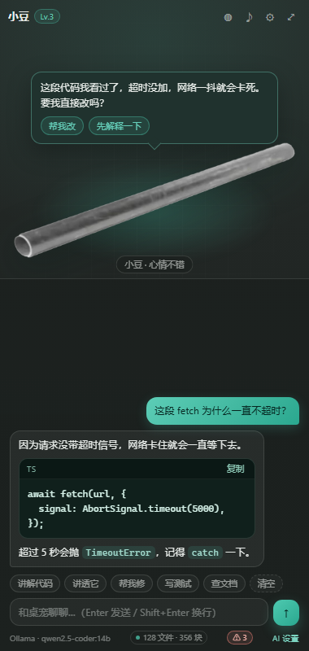
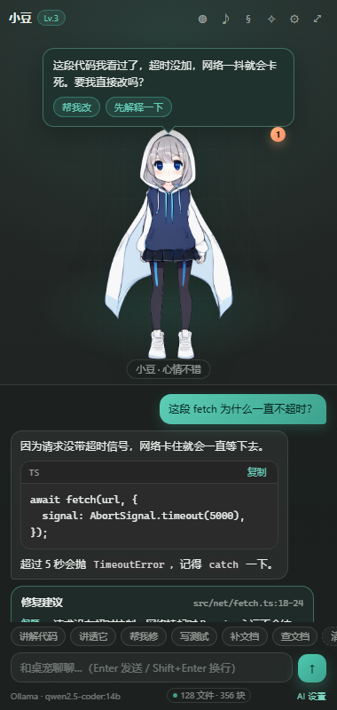
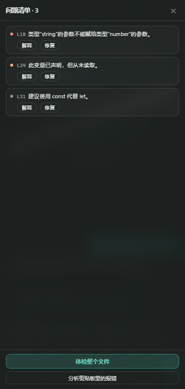

# AI 桌宠 · DeskPet

> 一只住在 VS Code 里的编程搭子：会聊天、会看你的代码、会陪你把 bug 修完，还能换成你自己画的 Live2D 或 3D 形象。

- **双形态**：常驻侧边栏，也可以拖成编辑器标签放大看。
- **真·代码辅助**：讲解选区、诊断修复、重构、生成测试、写 Git 提交信息。
- **会用形象和声音表达情绪**：保存成功会开心，报错会警觉，久坐会提醒你休息。
- **形象随便换**：Live2D（Cubism 4）、VRM / GLB、单张图片 / GIF，导入即用。
- **音效随便换**：按场景绑定自定义音效，没配就用内置合成音；支持系统 TTS 朗读。
- **AI 后端三选一**：本机 Ollama（默认）、任意 OpenAI 兼容接口、VS Code 语言模型 API。

> 需要 **VS Code 1.93+**（终端失败捕获依赖 Shell Integration；其它功能在更早版本也能用，但插件会要求 1.93）。



> 截图是开发期的界面预览，可在 `dev/preview.html` 里自己跑起来看。

---

## 功能

| 能力 | 说明 |
| --- | --- |
| 桌宠面板 | 侧边栏 + 编辑器标签两种形态，共用同一段对话与状态 |
| 流式对话 | 边生成边显示，可随时中断；对话历史保存在本地 |
| 代码讲解 | 选中代码 → 右键「讲解选中代码」，或用快捷键 `Ctrl+Alt+E` |
| 项目级上下文 | 索引整个代码库，提问时自动带上相邻模块、接口定义与命名约定 |
| 老师模式 | 逐行讲解 / 逻辑梳理 / 设计思路三种深度，按行号讲清“为什么” |
| 克制提醒 | 安静 / 平衡 / 话多三档，打字时自动静默，未读提醒用小角标而不弹窗 |
| 决策透明 | 修复/重构先给「问题·原因·方案·影响」卡片，再让你决定是否应用 |
| 智能检修 | 实时诊断角标、终端失败捕获、堆栈解析，解释 + 补丁 + 自动 diff |
| 诊断修复 | 读取 VS Code 诊断信息，给出可直接替换的修复代码，支持 diff 预览 |
| 重构 / 测试 | 按目标重构选区；为选区生成测试文件 |
| Git 提交信息 | 读 `git diff`，按 Conventional Commits 生成并一键填入提交框 |
| 资料查询 | 直接抓取文档 URL；配置 Tavily / Serper 后可联网搜索并给出带引用的回答 |
| 情绪与好感 | 点击、聊天、保存代码都会加好感，升级有专属台词 |
| 主动提醒 | 文件里有报错、构建/测试任务失败时提醒，并可直接触发修复或讲解 |
| 形象库 | 内置矢量形象 / 图片 / Live2D / 3D 一键切换，导入即用 |
| 音效库 | 点击、开心、提醒、出错、切换形象五个场景分别绑定音效 |
| 语音朗读 | 用系统 TTS 念回复，语速可调 |
| 隐私 | 无遥测；对话只发给你配置的 AI 接口；历史与素材保存在本机 |

---

## 快速开始

### 从源码运行

```bash
git clone https://github.com/<your-name>/ai-deskpet.git
cd ai-deskpet
npm install
npm run compile
```

用 VS Code 打开这个目录，按 **F5** 启动 Extension Host，然后在活动栏点「AI 桌宠」图标。

### 安装打包好的 vsix

```bash
npm run package
code --install-extension ai-deskpet-0.1.0.vsix
```

### 默认 AI：本机 Ollama

```bash
ollama serve
ollama pull qwen2.5-coder:14b
```

插件默认就指向 `http://127.0.0.1:11434/v1` + `qwen2.5-coder:14b`，装好 Ollama 即可对话。
换模型只需要改设置：

```jsonc
{
  "deskpet.ai.provider": "ollama",
  "deskpet.ai.baseUrl": "http://127.0.0.1:11434/v1",
  "deskpet.ai.model": "qwen3-coder:30b"
}
```

> 本地模型首次加载可能要几十秒；显存不够时 Ollama 会把模型放到内存，速度会明显变慢。

### 换成云端 / 任意 OpenAI 兼容接口

1. 运行命令 **AI 桌宠: 设置 AI 服务密钥**（`Ctrl+Shift+P` → `deskpet.setApiKey`）。
2. 选择「AI 服务密钥」并粘贴 Key（保存在 VS Code 的 SecretStorage，不会写进 settings.json）。
3. 修改设置：

```jsonc
{
  "deskpet.ai.provider": "openai",
  "deskpet.ai.baseUrl": "https://api.deepseek.com/v1",
  "deskpet.ai.model": "deepseek-chat"
}
```

通义千问、Kimi、vLLM、LM Studio 等只要是 OpenAI 兼容的 `/chat/completions` 都能用。

### 用 VS Code 自带的语言模型（Copilot）

```jsonc
{ "deskpet.ai.provider": "vscode-lm" }
```

需要已安装并登录 GitHub Copilot；没有订阅时请继续用 Ollama 或云端接口。

---

## 换形象

三种方式，都在 **形象库**（面板右上角 ◍）里完成：

| 类型 | 支持格式 | 说明 |
| --- | --- | --- |
| 默认 | 随包附带 | `assets/default/pet.png`（当前是一张金属水管贴纸）；删掉后回退到 SVG 小豆 |
| 图片 | png / jpg / gif / webp / svg / avif | 建议透明背景、1000px 以上；横版会自动加宽展示 |
| Live2D | `.model3.json`（Cubism 4） | 需要自备 Live2D 官方的 `live2dcubismcore.min.js` |
| 3D | `.vrm` / `.glb` / `.gltf` | VRM 支持表情与骨骼，普通 GLB 只做整体动效 |

### 导入

运行命令 **AI 桌宠: 导入桌宠形象**，选择模型文件即可：

- 单张图片：直接复制文件。
- Live2D：选中 `.model3.json`，插件会**把整个模型目录一起复制**（贴图、`.moc3`、物理文件都要）。
- 3D：选中 `.vrm` / `.glb`，同样会带上同目录的贴图与 `.bin`。

素材统一复制到插件的 globalStorage，源文件删了也不影响。

图片形象会自动适配宽高比：横版图片会把舞台撑宽、把更多空间让给对话区，不会缩成中间一条细带。

### 打包默认形象

当前仓库自带一张默认形象 `assets/default/pet.png`（金属水管透明贴纸，仅作演示）。
想换成自己的画，直接覆盖这个文件，或把图片放进 `assets/default/`（取目录里第一张），
它就会成为「默认形象」的外观。详见 [assets/default/README.md](assets/default/README.md)。

### Live2D 的额外一步

`live2dcubismcore.min.js` 是 Live2D 公司的专有文件，**不能随插件分发**。请到 [Live2D 官网](https://www.live2d.com/download/cubism-sdk/) 下载 Cubism SDK for Web，解压后找到 `Core/live2dcubismcore.min.js`，然后在设置里填：

```jsonc
{ "deskpet.pet.cubismCorePath": "D:/Live2D/CubismSdkForWeb-5-r.3/Core/live2dcubismcore.min.js" }
```

限制与建议：

- 只支持 **Cubism 4（moc3）** 模型，Cubism 2.1 不支持。
- 模型动作组建议命名为 `Idle` / `TapBody` / `Happy` / `Shake` 等，插件会按候选名匹配；匹配不到时会用程序化的呼吸、跳动、摇晃作为兜底。
- 单个模型建议控制在 20MB 以内。

### 3D（VRM / GLB）

- VRM 0.x 会自动翻转朝向（`VRMUtils.rotateVRM0`），VRM 1.0 直接可用。
- 支持的表情预设：`happy` / `surprised` / `relaxed`，动作有呼吸、眨眼、跳跃、摇晃。
- three.js 会按需加载（约 1.3MB），首次切到 3D 时稍有延迟。
- 低端集成显卡上建议把 `deskpet.pet.scale` 调小，或改用图片形象。

---

## 换声音

优先级从高到低：

1. 你用「音效库」绑定的文件（存于 globalStorage）
2. `assets/sounds/<槽位>.mp3|wav|ogg` 随插件分发的默认音效
3. WebAudio 实时合成的提示音（零素材也能响）

五个槽位：`click`（点击）、`happy`（开心 / 保存成功）、`alert`（提醒 / 报错）、`error`（出错）、`switch`（切换形象）。

当前随包附带了 `assets/sounds/click.mp3`（金属管敲击声），其余槽位默认使用合成音。
在 **音效库**（右上角 ♪）里可以逐个场景下拉选择、试听，或点「导入音效文件」新增。
语音朗读在 **设置** 里打开，使用系统语音合成（Windows 上通常是微软的中文语音包）。

---

## 项目级上下文（深度理解代码库）

桌宠不只看当前选区。启动后它会在后台给你的整个工作区建一份轻量索引（默认上限 4000 个源码文件），
提问或执行「讲解 / 修复 / 重构 / 写测试」时，会按下面的顺序自动拼装上下文：

1. **项目约定**：语言分布、文件名风格（kebab / snake / camel）、缩进、引号、分号习惯、
   测试文件命名、依赖线索（React / Vue / FastAPI / pytest…）。
2. **当前文件结构**：LSP 提供的符号大纲（类、函数、接口，带行号）、它 import 了谁、又被谁 import。
3. **相关定义**：光标所在符号的定义位置（通常是接口 / 类型 / 函数签名）会带一段上下文一起送进去，
   这就是「接口约束」的来源。
4. **跨文件检索**：对全库做 BM25 检索（标识符会按 camelCase / snake_case 拆词，中文按 2-gram），
   命中块按「相邻模块 + 同目录 + 路径关键词」加权，当前文件本身降权，避免复读你选中的代码。

所有环节都有字符预算（默认 8000 字符），超出按优先级截断。上下文窗口小的模型可以把
`deskpet.context.maxChars` 调到 4000~6000。

**为什么不用向量库**：BM25 + 依赖图 + LSP 符号在代码场景里已经能命中大部分「这个函数在哪、谁调用了它、
接口长什么样」的问题，而且零依赖、零上传、毫秒级。语义检索（本地 embedding）是后续可选项。

**索引的边界**：

- 只在内存里，重启 VS Code 会重建；保存文件时增量更新。
- 跳过 `node_modules`、`dist`、`build`、`.venv`、`target`、压缩产物和 220KB 以上的文件。
- 不索引图片、二进制和超长单行文件。
- 索引完全在本地完成，不会有任何内容被上传；只有你发起的对话才会把拼装好的上下文发给你配置的 AI 接口。

状态栏右下角会显示 `$(database) 1234 文件 · 5678 块`，点击可重建索引；
面板底部也有一个小小的索引状态徽标。

---

## 讲解、克制与决策透明

### 三种讲解深度

选中代码 → 右键「当老师讲透这段代码」，或点对话栏的 **讲透它**：

| 深度 | 产出 |
| --- | --- |
| 逐行讲解 | 按 `L12` 这样的行号逐条说明“这行做什么、为什么这么写”，跳过无信息量的行 |
| 逻辑梳理 | 按执行顺序拆步骤，标出分支、循环、提前返回、副作用，并用文字画数据流 |
| 设计思路 | 讲清核心问题、设计假设、替代方案的取舍、接口约束和扩展点 |

`Ctrl+Alt+E`（讲解选中代码）是简版；「讲透它」会额外带上光标符号在项目里的引用位置（`文件:行号`），
让模型能解释“谁在调用它、为什么这么调用”。默认深度可以在 `deskpet.teach.depth` 里改。

### 主动提醒怎么做到不烦人

桌宠的主动提醒（报错、构建失败、久坐）走统一的打扰策略：

| 等级 | 行为 |
| --- | --- |
| 安静 | 所有提醒只写进对话，不弹气泡；桌宠右上角出现未读角标 |
| 平衡（默认） | 重要提醒才弹气泡；**4 分钟内不重复弹**、每小时最多 6 次、**你正在打字时自动静默** |
| 话多 | 每次提醒都弹气泡 |

无论哪一档，提醒内容都不会丢失：安静的提醒会作为一条可操作的卡片留在对话里，
点一下桌宠即可清掉未读角标。久坐提醒被归为低优先级，在平衡模式下默认不弹气泡。

### 变更说明卡片

修复和重构**不再弹模态对话框**。模型必须先回答四个问题，再给代码：

```
【问题】哪里不对、你会看到什么现象
【原因】为什么会这样、触发条件
【方案】准备怎么改（最多 3 条）
【影响】会波及哪些调用方 / 行为 / 边界
```

然后对话里出现一张卡片，四个字段逐条展示，底部是 **先看差异 / 应用修改 / 复制代码 / 忽略**。
应用前可以先看并排 diff；应用后会提示“已应用到编辑器”，并把结果写回卡片。



应用前会校验选区内容有没有变化：如果你在看建议期间改了代码，卡片会拒绝应用并提示重新生成，
避免把新代码覆盖掉。

> 如果模型没有按格式输出，卡片会退化成“第一段当问题描述”，代码仍然可以正常应用。

---

## 智能检修（Debug & Fix）

三个入口，最终都汇到同一套「解释 → 定位 → 补丁 → diff」流程：

| 入口 | 怎么触发 | 能拿到什么 |
| --- | --- | --- |
| 实时诊断 | 面板底部的 `⚠ 3` 角标 | 当前文件的错误/警告清单，逐条「解释 / 修复」 |
| 终端失败 | 命令退出码非 0 时桌宠会问一句 | 最近一次命令的完整输出（VS Code 1.93+ Shell Integration） |
| 剪贴板/堆栈 | 命令「分析剪贴板里的报错 / 堆栈」 | 你从任何地方复制来的日志 |



### 堆栈会被解析成真实位置

支持 JS/TS、Python、Java/Kotlin、C#、Go、Rust 的常见格式，提取 `文件:行:列` 和函数名后：

1. 按工作区路径 / 文件名匹配到真实文件（找不到就只解释、不改代码）。
2. 用 LSP 找到**包含该行的最小符号**（函数/方法）作为替换范围，避免整文件重写。
3. 再附上另外 1-2 个调用帧的上下文，让模型判断是“这层写错了”还是“上层传错了”。

解释固定四段：**问题**（人话现象）、**原因**（哪个值不满足什么假设，指出真正出错点）、
**方案**、**影响**。随后给出**一个**完整代码块，只替换上面标注的那段代码。

### 补丁与差异

- 生成后默认自动打开**并排 diff**（`deskpet.fix.autoDiff` 可关）。
- 应用前会校验选区内容是否被改过；不一致就拒绝并提示重新生成。
- 应用成功后写回卡片状态，不会静默改文件。

### 静态体检

命令「体检当前文件」会让模型按清单检查：空值、边界、异常吞掉、资源泄漏、并发竞态、
类型断言滥用、异步未 await、循环重复计算、敏感信息泄漏。输出 `[高]/[中]/[低] L42` 的清单，
并给出“最该先修的一条”。它只报告，不直接改代码。

> 终端捕获依赖 VS Code 1.93 的 Shell Integration；如果你的终端没有启用 shell integration，
> 这个入口会自动跳过，其它入口不受影响。

---

## 设置项

| 设置 | 默认值 | 说明 |
| --- | --- | --- |
| `deskpet.pet.name` | `小豆` | 桌宠名字 |
| `deskpet.pet.renderer` | `builtin` | `builtin` / `image` / `live2d` / `vrm` |
| `deskpet.pet.modelPath` | 空 | 形象文件路径（绝对或相对工作区） |
| `deskpet.pet.cubismCorePath` | 空 | Cubism Core 脚本路径 |
| `deskpet.pet.scale` | `1` | 形象缩放 0.3–3 |
| `deskpet.pet.volume` | `0.6` | 音效音量 |
| `deskpet.pet.tts` | `false` | 朗读回复 |
| `deskpet.pet.ttsRate` | `1` | 朗读语速 |
| `deskpet.pet.showOnStartup` | `false` | 启动时自动展开侧边栏 |
| `deskpet.pet.breakReminderMinutes` | `50` | 久坐提醒间隔，0 关闭 |
| `deskpet.pet.reactOnSave` | `true` | 保存文件时做出反应 |
| `deskpet.pet.reactOnError` | `true` | 出现错误时提醒 |
| `deskpet.pet.interruption` | `balanced` | 打扰程度：`quiet` / `balanced` / `chatty` |
| `deskpet.teach.depth` | `line` | 讲透代码的默认深度：`line` / `logic` / `design` |
| `deskpet.ai.provider` | `ollama` | `ollama` / `openai` / `vscode-lm` |
| `deskpet.ai.baseUrl` | `http://127.0.0.1:11434/v1` | 接口地址 |
| `deskpet.ai.model` | `qwen2.5-coder:14b` | 模型名 |
| `deskpet.ai.temperature` | `0.6` | 采样温度 |
| `deskpet.ai.maxTokens` | `2048` | 单次回复上限 |
| `deskpet.ai.extraInstructions` | 空 | 附加人设 |
| `deskpet.docs.searchProvider` | `none` | `none` / `tavily` / `serper` |
| `deskpet.context.enabled` | `true` | 是否启用项目级上下文索引 |
| `deskpet.context.maxFiles` | `4000` | 索引文件数上限 |
| `deskpet.context.maxChars` | `8000` | 每次提问附带的上下文预算 |
| `deskpet.fix.autoDiff` | `true` | 从报错生成修复时自动打开并排 diff |
| `deskpet.debug.watchTerminal` | `true` | 捕获终端失败输出（需 VS Code 1.93+） |

---

## 命令与快捷键

| 命令 | 快捷键 | 说明 |
| --- | --- | --- |
| `deskpet.chat` | `Ctrl+Alt+P` | 聚焦桌宠并准备聊天 |
| `deskpet.explainSelection` | `Ctrl+Alt+E` | 讲解选中代码（无选区则讲光标附近） |
| `deskpet.teachSelection` | — | 当老师讲透：逐行 / 逻辑 / 设计思路 |
| `deskpet.fixSelection` | — | 诊断并修复，可应用 / 看 diff / 复制 |
| `deskpet.explainDiagnostic` | — | 用人话解释这一行的报错 |
| `deskpet.fixDiagnostic` | — | 修复这一行的报错（自动 diff） |
| `deskpet.analyzeFailure` | — | 分析最近一次失败的终端命令 |
| `deskpet.analyzeClipboard` | — | 分析剪贴板里的报错 / 堆栈 |
| `deskpet.reviewFile` | — | 静态体检当前文件 |
| `deskpet.refactorSelection` | — | 按目标重构选区 |
| `deskpet.addTests` | — | 为选区生成测试文件 |
| `deskpet.commitMessage` | — | 根据 git diff 生成提交信息 |
| `deskpet.searchDocs` | — | 查资料 / 抓取文档 URL |
| `deskpet.reindex` | — | 重建项目索引（也会在状态栏显示进度） |
| `deskpet.importModel` | — | 导入形象 |
| `deskpet.importSound` | — | 导入音效 |
| `deskpet.openPanel` | — | 在编辑器标签中打开桌宠 |
| `deskpet.setApiKey` | — | 设置 AI / 搜索密钥 |
| `deskpet.resetPet` | — | 重置好感度与对话 |

---

## 架构

```
ai-deskpet/
├─ src/                     扩展宿主（Node 侧）
│  ├─ extension.ts          激活、命令注册、事件反应、久坐提醒
│  ├─ config.ts             把设置 + 素材路径组装成 PetConfig
│  ├─ ai/                   Ollama / OpenAI 兼容 / VS Code LM 适配器、上下文采集、提示词
│  ├─ context/              项目索引（BM25）、依赖图、代码约定提取、LSP 符号解析
│  ├─ docs/search.ts        资料检索（直连 URL / Tavily / Serper）
│  ├─ commands/assist.ts    代码讲解、修复、重构、测试、提交信息
│  └─ pet/                  宿主侧：状态、素材库、webview 消息总线
├─ webview/                 webview 前端（浏览器侧）
│  ├─ main.ts               消息协议、UI 装配、抽屉、音效
│  ├─ pet/                  渲染器引擎 + 内置 SVG / 图片 / 按需加载的 Live2D、3D
│  └─ ui/                   Markdown 渲染、对话列表
├─ shared/protocol.ts       两端共享的消息类型
└─ assets/                  图标、默认立绘、默认音效
```

几个关键设计：

- **一个 `PetHost` 管所有 webview**：侧边栏和编辑器标签同时打开时共享对话、好感度和素材，消息会广播到所有存活的面板。
- **项目上下文单独一层**：`ProjectContext` 只负责“把仓库变成可检索的上下文”，不依赖 AI 适配器；
  检索结果是纯文本块，换任何模型都能用，也方便以后加 embedding 重排。
- **流式协议**：`send → chatStart → chatDelta* → chatEnd`，出错走 `chatError`，支持 `abort`。HTTP 侧的 SSE 解析在宿主进程完成，webview 只负责渲染。
- **按需加载渲染器**：Live2D 与 3D 各自是一个独立 bundle（esbuild 第二个入口），只有切到对应形象时才注入 `<script>`，首屏只有 40KB 左右。
- **安全边界**：webview 全程 CSP + nonce；Markdown 先转义再渲染，链接只允许 `http(s)`，外部链接交给 `vscode.env.openExternal`；API Key 存 SecretStorage。
- **素材不落配置差分**：导入时复制到 globalStorage，设置里只存绝对路径，避免用户移动源文件后白屏。

---

## 本地开发

```bash
npm install
npm run compile     # 构建 dist/
npm run watch       # 监听模式
npm run typecheck   # 只做类型检查
npm run preview     # 起一个静态服务，看 dev/preview.html
```

`dev/preview.html` 是纯前端的界面预览：用 stub 的 `acquireVsCodeApi` 注入一段示例数据，
可以在浏览器里快速调样式，不用每次重载 VS Code。改完 `webview/` 后需要先 `npm run compile`。

调试扩展本体：VS Code 打开仓库 → F5 → 在 Extension Host 窗口里操作。

---

## 打包与发布

```bash
npm run package     # 类型检查 + 生产构建 + 生成 vsix
```

发布到 VS Code Marketplace：

1. 改 `package.json` 的 `name` / `publisher` / `displayName`（现在 publisher 是占位符 `your-publisher-id`）。
2. 把 `package.json` 里的 `repository` / `homepage` / `bugs` 和本 README 里的仓库地址换成你的。
3. 在 Azure DevOps 创建 Personal Access Token（Marketplace → Manage 权限）。
4. 登录并发布：

```bash
npx vsce login <publisher>
npx vsce publish
```

GitHub 仓库：

```bash
git init
git add .
git commit -m "feat: initial release"
git branch -M main
git remote add origin https://github.com/<you>/ai-deskpet.git
git push -u origin main
```

`.github/workflows/ci.yml` 会在每次 push / PR 时做类型检查、构建并产出 vsix；
打 tag（如 `v0.1.0`）时 `release.yml` 会自动创建 GitHub Release 并附上 vsix。

> 注意：**不要把 `live2dcubismcore.min.js` 或任何 Live2D 官方示例模型提交到仓库**，
> 它们的许可不允许再分发。仓库里也不要放没有授权的角色素材。

---

## 隐私

- 插件**没有**任何遥测、统计或远程日志。
- 对话内容只会发送到你自己配置的 AI 接口（Ollama 在本机；云端接口由你填写的 Key 决定）。
- 只有在你主动点击「查文档」或输入 URL 时才会发起外部网页请求。
- 对话历史、好感度、导入的素材都保存在本机的 VS Code globalStorage 里，命令面板里的
  「重置桌宠」可以一次性清空。

## 已知限制

- VS Code 插件 API 无法创建覆盖在编辑器之上、始终置顶的透明窗口，所以「桌宠」只能在侧边栏 / 编辑器标签里。真·桌面悬浮需要额外的 Electron 伴侣进程，暂未实现（见路线图）。
- Live2D 仅支持 Cubism 4；Cubism 2.1 模型需要另一套 runtime，未打包。
- 本地大模型首次加载慢、上下文窗口有限；长对话会截断较早的消息。
- 3D 渲染在集成显卡上可能掉帧，可在设置里调小形象尺寸。
- 资料查询受目标站点反爬与 CSP 限制，抓不到正文时会退回搜索摘要。

---

## 路线图

- [ ] 可选的置顶悬浮窗伴侣（Electron / Tauri，通过本地 WebSocket 与插件通信）
- [ ] 语音输入（Whisper / 系统听写）
- [ ] 形象包市场：一键安装 Live2D / VRM 主题
- [ ] 项目索引升级：本地 embedding 语义检索 + 跨文件调用链分析
- [ ] 多语言界面（English / 日本語）
- [ ] 单元测试与 webview E2E（Playwright）
- [ ] 对话内直接执行「应用 diff / 新建文件」的事务式确认

---

## 贡献

欢迎 Issue 和 PR。提交前请确保：

```bash
npm run typecheck && npm run compile
```

代码风格保持现状（2 空格、单引号、中文注释解释「为什么」而不是「是什么」）。
新增设置项请同步更新 README 的设置表。

## 许可证

[MIT](LICENSE)。第三方依赖的许可证见各自仓库；Live2D Cubism Core 与模型素材的版权归各自权利人所有，本项目不附带这些文件。
